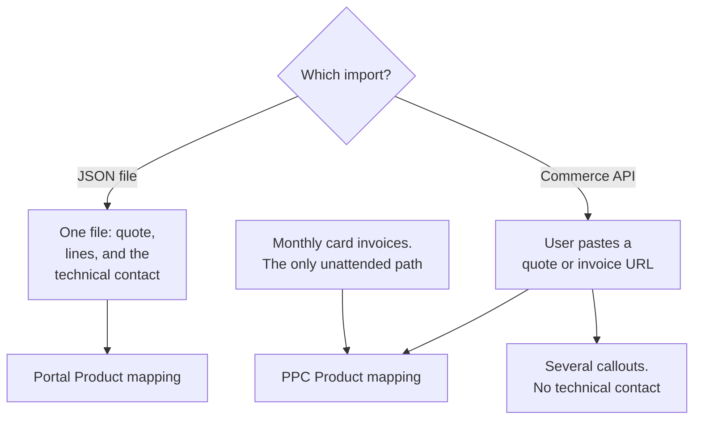
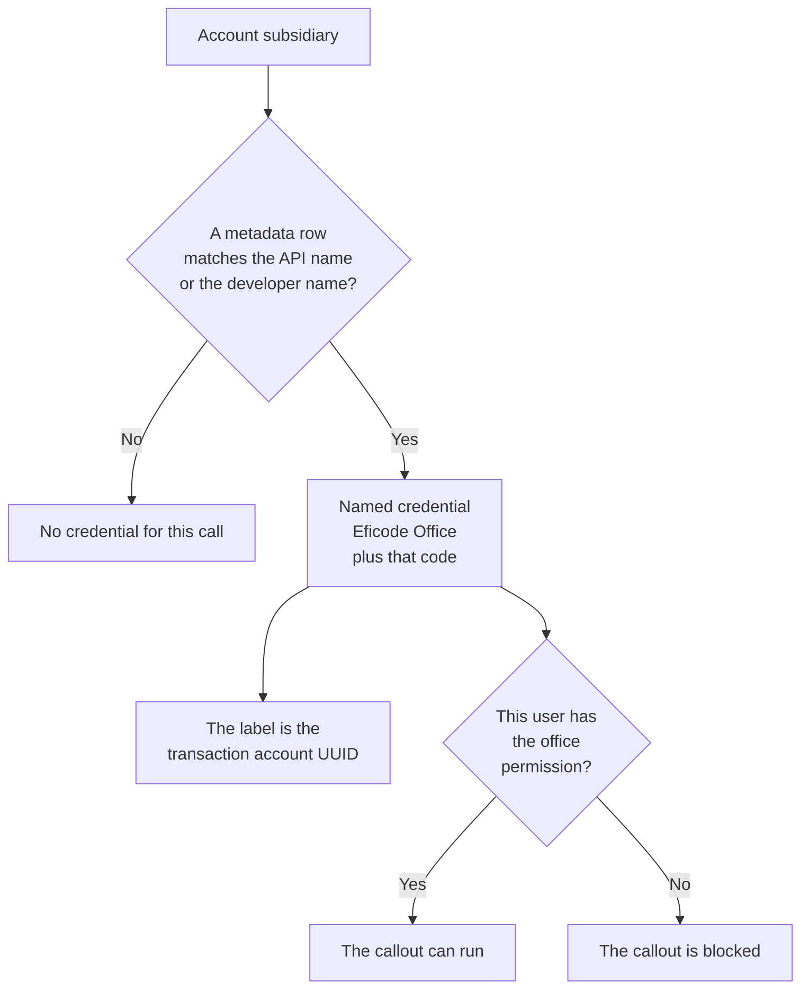
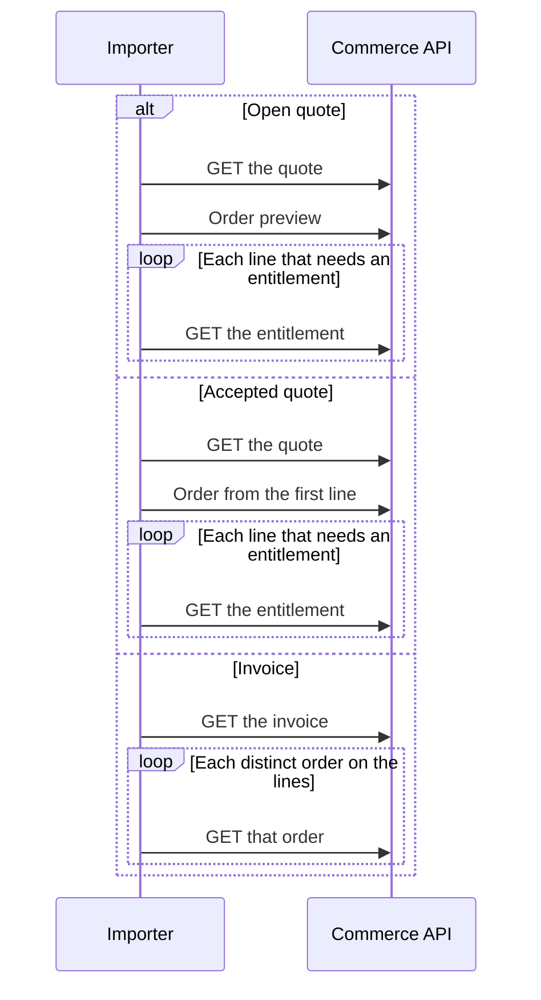
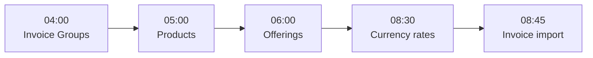

# Atlassian Partner Portal Commerce integration

This document describes how Eficode Salesforce talks to the Atlassian Partner Portal Commerce (PPC) API: subsidiaries, credentials, product mapping, and why a single quote or invoice is assembled from several API calls.

License sales that start in the Atlassian partner portal need to exist on Salesforce Opportunities so reporting and the existing Salesforce-to-NetSuite path see the same deals as services sales.

---

## Table of Contents

1. [What this covers](#what-this-covers)
2. [Two import paths](#two-import-paths)
3. [Subsidiaries and transaction accounts](#subsidiaries-and-transaction-accounts)
4. [Why one record needs many API calls](#why-one-record-needs-many-api-calls)
5. [Configuration](#configuration)
6. [Main Apex](#main-apex)
7. [Production schedule](#production-schedule)
8. [Related docs](#related-docs)

---

## What this covers

Salesforce users bring Atlassian license quotes and invoices onto Opportunities as Opportunity Products. Billing profiles from PPC are stored as Invoice Groups and linked to Accounts by hand. A nightly job keeps those Invoice Groups current. A separate scheduled job can create Opportunities from paid monthly card invoices.

Callouts go through `PortalCommerceApiClient` using `callout:{NamedCredential}/commerce/api/...`.

Authentication headers come from named-credential merge fields:

- `Authorization: Bearer {!$Credential.Password}` (API token)
- `X-transaction-account: {!$Credential.Username}` (transaction account UUID)

---

## Two import paths

| Path | When it is used | Product mapping metadata | Lightning component |
| --- | --- | --- | --- |
| JSON file from the older portal export | A user uploads a quote JSON file on the Opportunity | `PortalProductToSalesforceMapping__mdt` | `partnerPortalJsonImporter` |
| Commerce API | A user pastes a quote or invoice URL, or the monthly job imports invoices | `PpcProductToSalesforceMapping__mdt` | `partnerPortalApiQuoteImporter`, `partnerPortalApiInvoiceImporter`, `partnerPortalApiInvoiceViewer` |

The JSON file contains the quote, line items, and the technical contact in one payload. The Commerce API does not. Quote and invoice imports call entitlements, orders, and order preview (for open quotes) before the Opportunity Products can be built. The Commerce API import does not receive a technical contact.

A fully automatic poll of every new quote was not built. The Commerce API does not support the filters that would make that poll reliable. Users select the quote or invoice. Monthly card invoices are the exception: those are imported on a schedule for Accounts that opt in. See [Monthly invoice auto-import](Monthly_Invoice_Auto_Import.md).

---

## Subsidiaries and transaction accounts

PPC has no customer object that matches a Salesforce Account. A customer is one or more billing profiles. Each Eficode subsidiary is a separate PPC transaction account, because bookkeeping must stay separate. The Account field `CV_Subsidiary__c` decides which credential every call uses.

For each subsidiary:

| Piece | Role |
| --- | --- |
| Named credential `Eficode_Office_{CODE}` | Username is the transaction account UUID. Password is that account's API token. Generate Authorization Header is off. Allow Merge Fields in HTTP Header and HTTP Body are on. |
| Custom metadata `PPC_TransactionAccount__mdt` | Label is the transaction account UUID. `SubsidiaryApiName__c` is the Account subsidiary API value (for example `FI`, or `Jodocus GmbH`). The record developer name is the named-credential suffix (`FI`, `JODOCUS`, …). |
| Custom permission `Eficode_Office_{CODE}` | `PortalCommerceApiAccessMgmt` checks this permission before a user can call that office. |

`PortalCommerceApiAccessMgmt.translateApiNameToNamedCredential` loads every `PPC_TransactionAccount__mdt` row and accepts either `SubsidiaryApiName__c` or the record developer name. The developer name is the named-credential suffix. The record label is the transaction account UUID sent as `X-transaction-account`.

The JSON file upload does not call PPC, so it skips this lookup. A manual import uses the user who clicks the button. A scheduled job uses the user who scheduled it.

| Developer name | `SubsidiaryApiName__c` (Account `CV_Subsidiary__c`) | Named credential |
| --- | --- | --- |
| `CH` | `CH` | `Eficode_Office_CH` |
| `DE` | `DE` | `Eficode_Office_DE` |
| `DK` | `DK` | `Eficode_Office_DK` |
| `FI` | `FI` | `Eficode_Office_FI` |
| `JODOCUS` | `Jodocus GmbH` | `Eficode_Office_JODOCUS` |
| `NL` | `NL` | `Eficode_Office_NL` |
| `NO` | `NO` | `Eficode_Office_NO` |
| `SE` | `SE` | `Eficode_Office_SE` |
| `UK` | `UK` | `Eficode_Office_UK` |
| `US` | `US` | `Eficode_Office_US` |

A new subsidiary needs all three: a named credential, a `PPC_TransactionAccount__mdt` record, and the matching custom permission. The label must be that subsidiary's transaction account UUID. Credential failures are monitored separately. See [PPC credential health](PPC_Credential_Health.md).

Quote fetch, invoice fetch, the Account invoice list, and the monthly importer all resolve the credential this way from the Account subsidiary. The JSON file upload does not call PPC, so it does not use this metadata.

---

## Why one record needs many API calls

| Situation | What the code does |
| --- | --- |
| Open quote | Quote payload is incomplete. An order preview is loaded and parsed. |
| Accepted quote | The order id is taken from the first line, and that order is loaded. |
| Entitlement, ARI, and slug | A separate entitlements call is made per line that needs them. |
| Invoice | Each invoice line points at an order and order item. Those orders are loaded, then line fields are filled from the order items. |
| Billing profiles | There is no customer id to query. All billing profiles for every transaction account are imported as Invoice Groups. Sales then sets `InvoiceGroup__c.Account__c`. |
| Paging | List calls return pages (50 records for invoice groups). The sync follows `nextId` until the page is exhausted, then moves to the next office. |
| Large quotes | Line-level calls add up. A large quote is many callouts. |

Entitlement calls are part of quote import. Invoice import does not make them. It loads one order per distinct order id on the invoice lines. Product mapping for both paths is in [Quote and invoice import](Quote_And_Invoice_Import.md).

Invoice lists on an Account only include Invoice Groups with `Active__c = true`. One callout is made per active Invoice Group, using the Account's subsidiary credential.

---

## Configuration

These are the metadata and settings the import features read. Matching rules for the two product tables are in [Quote and invoice import](Quote_And_Invoice_Import.md#product-mapping). The auto-import setting is in [Monthly invoice auto-import](Monthly_Invoice_Auto_Import.md#ppc-invoice-auto-import-settings).

| Metadata | Type | Used by |
| --- | --- | --- |
| `PPC_TransactionAccount__mdt` | Custom metadata | Every Commerce API call. Maps Account `CV_Subsidiary__c` to `Eficode_Office_{CODE}` and the transaction account UUID. See [Subsidiaries and transaction accounts](#subsidiaries-and-transaction-accounts). |
| `PortalProductToSalesforceMapping__mdt` | Custom metadata | JSON quote upload only (`PortalProductMapper`). Product name, platform, and edition. |
| `PpcProductToSalesforceMapping__mdt` | Custom metadata | Commerce API quote import, Commerce API invoice import, and the monthly invoice job (`PpcPortalProductMapper`). Description text before `(`. |
| `PPC_InvoiceAutoImportSettings__c` | Hierarchy custom setting | Monthly job (on/off, how many days back, pending-invoice cleanup) and both manual Commerce API imports (date-range merge). |
| `PPC_HealthCheckSettings__c` | Hierarchy custom setting | Credential health probes. See [PPC credential health](PPC_Credential_Health.md). |
| `CurrencyRateMarkup__mdt` | Custom metadata | Markup applied by the morning currency job. See [Currency rate import](Currency_Rates.md). |

---

## Main Apex

| Class | Role |
| --- | --- |
| `PortalCommerceApiClient` | HTTP callouts through the office named credential |
| `PortalCommerceApiAccessMgmt` | Office permissions, named-credential names, transaction account ids |
| `PortalCommerceApiQuotes`, `PortalCommerceApiInvoices`, `PortalCommerceApiOrders`, `PortalCommerceApiEntitlements`, `PortalCommerceApiInvoiceGroups`, `PortalCommerceApiOfferings`, `PortalCommerceApiProducts` | API resources |
| `PortalCommerceApiController` | Aura-enabled entry points used by the Lightning components |
| `PortalJsonParser`, `PortalQuoteConverter`, `OpportunityProductMapper`, `PortalProductMapper` | JSON file import |
| `PpcQuoteConverter`, `PpcInvoiceConverter`, `PpcOpportunityProductMapper`, `PpcPortalProductMapper` | Commerce API import |
| `PortalInvoiceGroupSyncSchedulable`, `PortalInvoiceGroupSyncQueueable` | Nightly billing-profile sync |
| `PortalProductSyncSchedulable`, `PortalProductSyncQueueable` | Daily sync of PPC products into `AtlassianProduct__c` (FI credential) |
| `PortalOfferingsSyncSchedulable`, `PortalOfferingsSyncBatch` | Daily sync of offerings for those products into `AtlassianOffering__c` |
| `PpcInvoiceImporterBatch`, `InvoiceToOpportunityBatch`, `ProcessOpportunityLinesQueueable` | Monthly invoice auto-import |
| `CurrencyRateUpdateScheduler`, `CurrencyRateUpdateQueueable` | Daily exchange rates into `DatedConversionRate` and `Buying_Exchange_Rate__c`. See [Currency rate import](Currency_Rates.md). |

---

## Production schedule

Queried from Eficode production (`EficodeProd`). All of these jobs are in state WAITING. Times are the org timezone, `Europe/Helsinki`.

| Scheduled job | Apex class | Cron | When |
| --- | --- | --- | --- |
| `Apex InvoiceGroups Atlassian PPC` | `PortalInvoiceGroupSyncSchedulable` | `0 0 4 ? * 1,2,3,4,5,6,7` | Daily at 04:00 |
| `Apex Portal Product Sync` | `PortalProductSyncSchedulable` | `0 0 5 ? * 1,2,3,4,5,6,7` | Daily at 05:00 |
| `Apex Portal Offerings Sync` | `PortalOfferingsSyncSchedulable` | `0 0 6 ? * 1,2,3,4,5,6,7` | Daily at 06:00 |
| `Apex Morning Currency Rate Import` | `CurrencyRateUpdateScheduler` | `0 30 8 * * ?` | Daily at 08:30. See [Currency rate import](Currency_Rates.md). |
| `Apex Morning Auto Invoice Import` | `PpcInvoiceImporterBatch` | `0 45 8 * * ?` | Daily at 08:45 |
| `PPC Credential Health Check 0` | `PpcCredentialHealthSchedulable` | `0 0 * * * ?` | Every hour at :00 |
| `PPC Credential Health Check 1` | `PpcCredentialHealthSchedulable` | `0 20 * * * ?` | Every hour at :20 |
| `PPC Credential Health Check 2` | `PpcCredentialHealthSchedulable` | `0 40 * * * ?` | Every hour at :40 |

Credential health is not in that morning chain. It runs on its own, every hour at :00, :20, and :40.

Product sync runs before offerings sync. Currency rates are refreshed at 08:30, before the 08:45 invoice import, so new Opportunity Products can pick up that day's USD rate. See [Currency rate import](Currency_Rates.md).

---

## Related docs

- [Invoice groups](Invoice_Groups.md)
- [Quote and invoice import](Quote_And_Invoice_Import.md)
- [Monthly invoice auto-import](Monthly_Invoice_Auto_Import.md)
- [Currency rate import](Currency_Rates.md)
- [Default Opportunity Owner](Default_Opportunity_Owner.md)
- [Promotion codes](Promotion_Codes.md)
- [PPC credential health](PPC_Credential_Health.md)
- [Quote and invoice PDF preview](Quote_And_Invoice_PDF_Preview.md)
