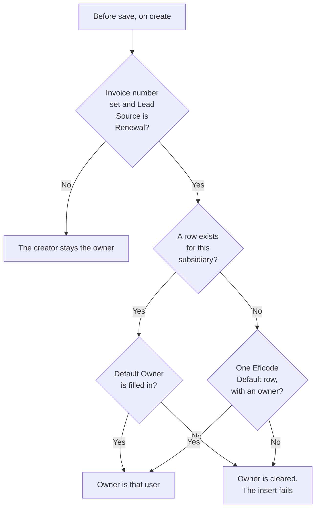

# Default Opportunity Owner

`DefaultOpportunityOwner__c` says which Salesforce user should own an Opportunity that the monthly Atlassian invoice import creates. The active flow **Set default owner on imported renewal oppty** applies it before the Opportunity is saved.

Manual quote and invoice import onto an existing Opportunity do not use this object. Those updates do not create the Opportunity.

---

## Table of Contents

1. [What it is for](#what-it-is-for)
2. [Fields](#fields)
3. [The flow](#the-flow)
4. [How to configure a subsidiary](#how-to-configure-a-subsidiary)
5. [What the flow does not cover](#what-the-flow-does-not-cover)

---

## What it is for

`PpcInvoiceImporterBatch` inserts the Opportunity as the user who scheduled the job. Without this flow, that integration user would own every monthly renewal.

The batch sets two fields that the flow requires:

| Opportunity field | Value from the batch |
| --- | --- |
| `LeadSource` | `Renewal` |
| `ImportedInvoiceNumber__c` | The Atlassian invoice number |

The flow then replaces `OwnerId` with the user configured for the Account's subsidiary.

Object label: **Default Opportunity Owner**. Description on the object: default opportunity owner (User) based on subsidiary. Sharing is Read/Write. Field history is on.

---

## Fields

| Field | Label | Role |
| --- | --- | --- |
| `Name` | Default Opportunity Owner Name | Record name. Not used by the flow. |
| `Subsidiary__c` | Subsidiary | Restricted picklist. The flow matches this to `Account.CV_Subsidiary__c`. Store the API value, not the label. Germany is API value `Jodocus GmbH`. |
| `DefaultOwner__c` | Default Owner | Lookup to User. This becomes `Opportunity.OwnerId`. |
| `EficodeDefaultOwner__c` | Eficode Default | When checked, this row is the fallback for any subsidiary that has no own row. |

Subsidiary values on this object match Account **Eficode Subsidiary** (`CV_Subsidiary__c`): Denmark `DK`, Finland `FI`, Germany `Jodocus GmbH`, Netherlands `NL`, Norway `NO`, Sweden `SE`, Switzerland `CH`, United Kingdom `UK`, United States `US`, Poland `PL`, Other, plus inactive values still on the picklist (Ex-Germany `DE`, and the Solidify companies).

The list view **All** shows name, subsidiary, Eficode Default, default owner, and last modified.

---

## The flow

| | |
| --- | --- |
| Label | Set default owner on imported renewal oppty |
| API name | `Set_default_owner_on_imported_renewal_oppty` |
| Type | Record-triggered, before save, on create |
| Object | Opportunity |
| Active version | 3 |

It runs only when both entry conditions are true:

- `ImportedInvoiceNumber__c` is not blank
- `LeadSource` is `Renewal`

Then:

1. Look up one `DefaultOpportunityOwner__c` where `Subsidiary__c` equals `Account.CV_Subsidiary__c`.
2. If that row exists, set `Opportunity.OwnerId` to its `DefaultOwner__c`.
3. If no subsidiary row exists, look up one row where `EficodeDefaultOwner__c` is checked, and set `OwnerId` to that row's `DefaultOwner__c`.

There is no sort. If two rows share the same subsidiary, or two rows have **Eficode Default** checked, Salesforce returns one of them. Keep a single row per subsidiary, and a single fallback row.

The lookup does not check that `DefaultOwner__c` is filled in. A matching row with an empty owner sets `OwnerId` to null, and the Opportunity insert fails. The fallback assignment runs even when no fallback row exists, which has the same result.

Because this is before save, the owner is correct on insert. Later owner-change notifications see the configured user, not a change from the integration user.

---

## How to configure a subsidiary

1. Open **Default Opportunity Owners**.
2. For a country that should have its own owner, create a row with `Subsidiary__c` equal to the Account subsidiary API value and `DefaultOwner__c` set to an active user. Leave **Eficode Default** unchecked.
3. Create one fallback row with **Eficode Default** checked and a user in `DefaultOwner__c`. Subsidiary on that row is not read.

The monthly job is `Apex Morning Auto Invoice Import`. See [Monthly invoice auto-import](Monthly_Invoice_Auto_Import.md). The user who owns the new Opportunity must be allowed to own Opportunities. An inactive user in `DefaultOwner__c` fails the insert.

---

## What the flow does not cover

| Path | Why the flow stays out |
| --- | --- |
| Manual Commerce API quote or invoice import | Updates an Opportunity that already exists. The flow is create-only. Those converters set `ImportedInvoiceNumber__c` and do not set `LeadSource` to `Renewal`. |
| JSON quote upload | Does not create the Opportunity and does not set those two fields. |
| A new Opportunity with a blank invoice number, or a lead source other than Renewal | Entry conditions fail, so the creator stays the owner. |
