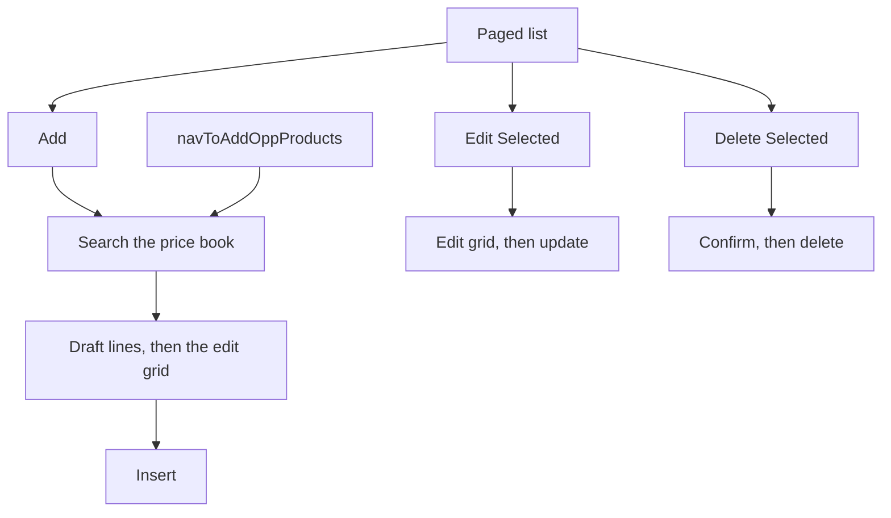
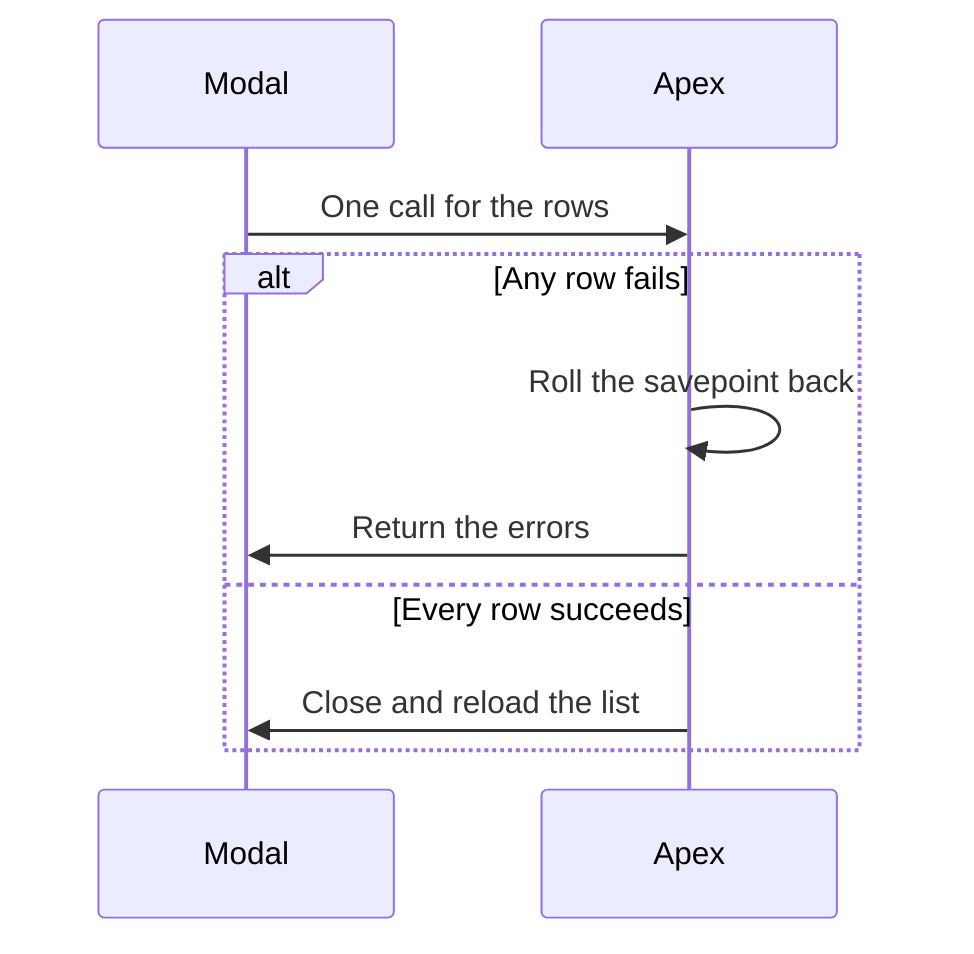

# Opportunity product editor

`opportunityLineItemList` is a custom Opportunity Product grid on the Opportunity record page. Add, edit, and delete run in modals. The standard related list is a separate page, opened from `navToAddOppProducts` only as a navigation target.

The grid is read-only. Picklist and currency columns display values. Changes are made in the add and edit modals, which use `opportunityLineItemsEditDatatable`.

`navToAddOppProducts` opens the add modal directly. **Next** on the search step opens the grid even when no product was chosen.

---

## Table of Contents

1. [List](#list)
2. [Add](#add)
3. [Edit and delete](#edit-and-delete)
4. [URL entry point](#url-entry-point)
5. [Save behavior](#save-behavior)
6. [Supporting Apex](#supporting-apex)

---

## List

`opportunityLineItemList` loads when the Opportunity record is available. Currency comes from `Opportunity.CurrencyIsoCode` via `getRecord`.

`OpportunityLineItemController.getOpportunityLineItems` returns pages of 30, ordered by `PricebookEntry.Product2.Name` ascending, `NULLS LAST`. Scrolling loads the next page and appends it. Sorting a sortable column reloads from the first page with that field and direction. The Product column is a link to the line and is not sortable.

Buttons:

| Button | Behavior |
| --- | --- |
| Add Opportunity Products | Opens the add modal |
| Refresh | Reloads the first page |
| Edit Selected | Disabled until at least one row is selected |
| Delete Selected | Disabled until at least one row is selected |

The empty state text is "No opportunity products have been added."

Columns: Product, Quantity, Units (`Units__c`), Unit Price (Opportunity currency), Discount (`Discount__c`), Total Sales Price Inc. Discount (`Total_List_Price_Incl_Discount__c`), Type (`Renewal__c`), Start Date (`License_Start_date__c`), End Date (`License_end_date__c`), Additional Info, LIC: Editable Unit List Price in USD, LIC: Editable Cost Price in USD, LIC: SEN, User Count, LIC: Unusual Discount Reviewed, LIC: Loss Reviewed.

Unit of Measure is queried and the column is commented out, so it is not shown.

---

## Add

`opportunityLineItemsAddModal` has two steps.

**Search Products.** `pricebookEntrySearchForm` calls `PricebookEntryController.getPricebookEntries`. The query uses the Opportunity price book and currency, `PricebookEntry.IsActive = true`, and `Product2.IsActive = true`. Filters:

| Filter | Match |
| --- | --- |
| Name | `Product2.Name LIKE` the typed text, wrapped in `%`. The search runs 500 ms after typing stops. |
| Revenue type | `Product2.Revenue_Type__c`, picklist from `ProductController.getRevenueTypePicklistValues` |
| Product family | `Product2.Family` |
| Business area | `Product2.Business_Area__c` |

Pages are 30, sorted by `Product2.Name` ascending. Choosing a row adds a draft line: quantity 1, unit price from the price book entry, a temporary id, and the other fields blank. The same product can be added more than once. A trash icon on the search step removes a draft line before it is saved. **Next** goes to the grid even when nothing was selected.

**Add Opportunity Products.** The edit grid lists the drafts. **Back** returns to search and keeps the drafts. **Done** inserts them.

---

## Edit and delete

`opportunityLineItemsEditModal` loads the selected ids with `getOpportunityLineItemsByIds` and saves with `updateOpportunityLineItems`.

`opportunityLineItemsDeleteModal` loads the same ids, lists them, and deletes with `deleteOpportunityLineItems`.

Editable columns on the add and edit grid: Quantity, Units, Unit List Price (`UnitPrice`, Opportunity currency), Discount, Type (`Renewal__c`, labeled **Type \***), Start Date, End Date, Additional Info, both LIC USD prices, SEN, User Count, Unusual Discount Reviewed, Loss Reviewed. Product name is not editable. The add grid also has a row delete icon (`isDeletable`). The edit modal does not.

`Renewal__c` and `Units__c` options come from `getTypePicklistValues` and `getUnitsPicklistValues`, plus a blank **--None--** choice.

The save payload also copies `SEN_Technical_Contact__c` when that value is already on the row. The current column list has no technical-contact column, so the grid does not collect one. `eficodeDatatable` has a contact cell type, and `ContactController.getContacts` searches `Contact.Name` for that cell. No column in this editor uses that type.

---

## URL entry point

`navToAddOppProducts` is URL-addressable. It reads `c__oppId` from the page state and opens the add modal immediately. **Back to opportunity** opens the Opportunity. The list-view handler navigates to the standard `OpportunityLineItems` related list.

---

## Save behavior

Insert and update send a map of lines to Apex. Delete sends ids. All three use `allOrNone = false` and then roll back the whole savepoint if any row failed. One bad line saves nothing. Errors are returned to the modal and the modal stays open. A clean save closes the modal with `submit`, toasts success, and the list reloads.

Insert sets `OpportunityId`, `PricebookEntryId`, `Name`, `UnitPrice`, `Quantity`, `Discount__c`, `Units__c`, `Renewal__c`, license start and end, `Additional_Info__c`, `SEN__c`, `User_Count__c`, `Loss_Reviewed__c`, `Unusual_discount_reviewed__c`, `Editable_Cost_Price_in_Dollars__c`, `Editable_Unit_List_Price_in_USD__c`, and `SEN_Technical_Contact__c`. Update sends those plus `Id`. Salesforce still runs validation, price book rules, and the other Opportunity Product automation on that DML.

---

## Supporting Apex

| Class | Used for |
| --- | --- |
| `OpportunityLineItemController` | List, get by ids, `Renewal__c` and `Units__c` picklists, insert, update, delete |
| `PricebookEntryController` | Product search in the Opportunity price book and currency |
| `ProductController` | Revenue type, family, and business area picklists for the search filters |
| `OpportunityController.getOpportunity` | Returns `Id` and `CurrencyIsoCode`. The list and the search form do not call it. They read currency with `getRecord`. |
| `ContactController` | Contact name search for the datatable contact cell. This editor's columns do not use that cell. |
