# T1, T2, and T3 opportunity splits

`OppSplitEngine` creates and deletes `OpportunitySplit` rows for the split types labeled **T1**, **T2**, and **T3**. `customOppTrigger` calls it after insert and after update, and only when `AutomationSettings__c.Automation_Enabled__c` is true.

The older record-triggered flows that assigned those splits are **Obsolete**. One screen flow is still active and can add a split by hand. UK and US flows that calculate the T2 and T3 amounts are still active. Those amounts are what make an Opportunity eligible for T2 and T3 splits. The amount formulas themselves are in [Tier calculation](Tier_Calculation.md).

`AutomationSettings__c` is not in this repository. Apex reads it with `getInstance()`. The fields used here are `Automation_Enabled__c` and, on validation, `Validation_Rule_Enabled__c`. A missing setting, or the checkbox unchecked, means the engine does not run.

---

## Table of Contents

1. [When the engine runs](#when-the-engine-runs)
2. [What a split row looks like](#what-a-split-row-looks-like)
3. [T1](#t1)
4. [T2](#t2)
5. [T3](#t3)
6. [Owner change and cleanup](#owner-change-and-cleanup)
7. [Run Splits Flow](#run-splits-flow)
8. [Quotas Update Allowed](#quotas-update-allowed)
9. [Screen flow](#screen-flow)
10. [Flows that are still active](#flows-that-are-still-active)
11. [Obsolete split flows](#obsolete-split-flows)

---

## When the engine runs

`customOppTrigger` (after insert, after update) calls `OppSplitEngine.execute` when both of these are true:

- `OppSplitService.isAutomationEnabled()` is true.
- `tryEnterAutomation()` succeeds. That flag stays set for the rest of the transaction, so the Opportunity update the engine itself performs (`T1_Opp__c`, `Run_Splits_Flow__c`) does not run the engine a second time.

The engine loads the Opportunity again for `Account.OwnerId` and `Account.T1_Start_Date__c`. Split type ids come from `OpportunitySplitType` where `MasterLabel` is `T1`, `T2`, or `T3`. A missing label means that tier's id is null and an insert of that tier fails.

DML order at the end of the run: delete, then insert, then update existing splits, then update Opportunities.

Closed Opportunities (`IsClosed`) skip T1/T2/T3 assignment, the close-date gate, owner-change inserts, and all deletions. Two paths still run on a closed Opportunity: [T1 eligibility reconciliation](#t1-eligibility-reconciliation) when Quotas Update Allowed is true, and [Run Splits Flow](#run-splits-flow) when that checkbox flips to true.

Run Splits Flow is decided before the quota check. It still runs when the Opportunity is closed.

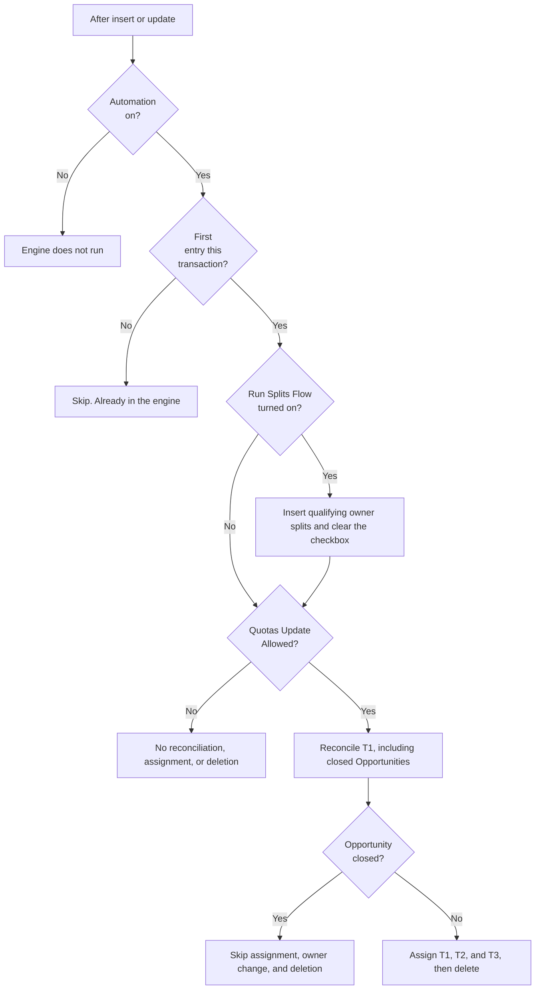

---

## What a split row looks like

Each created row is:

| Field | Value |
| --- | --- |
| `OpportunityId` | The Opportunity |
| `SplitOwnerId` | The Opportunity owner, or the Account owner when that user is different |
| `SplitTypeId` | The T1, T2, or T3 type |
| `SplitPercentage` | `100` |

The engine does not lower another owner's percentage. The same owner and type is not inserted twice. The key is Opportunity id + owner id + split type id.

`Second_opp_owner__c` (label **2nd Opp Owner**) is not given a new split. That user is only protected from [stale-owner deletion](#owner-change-and-cleanup).

---

## T1

T1 uses `Account.T1_Start_Date__c` (label **T1 Start Date**, field default 1 July 2025) and `Opportunity.T1_Opp__c` (`Yes` or `No`).

### Normal assignment

Owner splits in the diagrams below are the Opportunity owner, and the Account owner when that user is different. Each row is 100%.

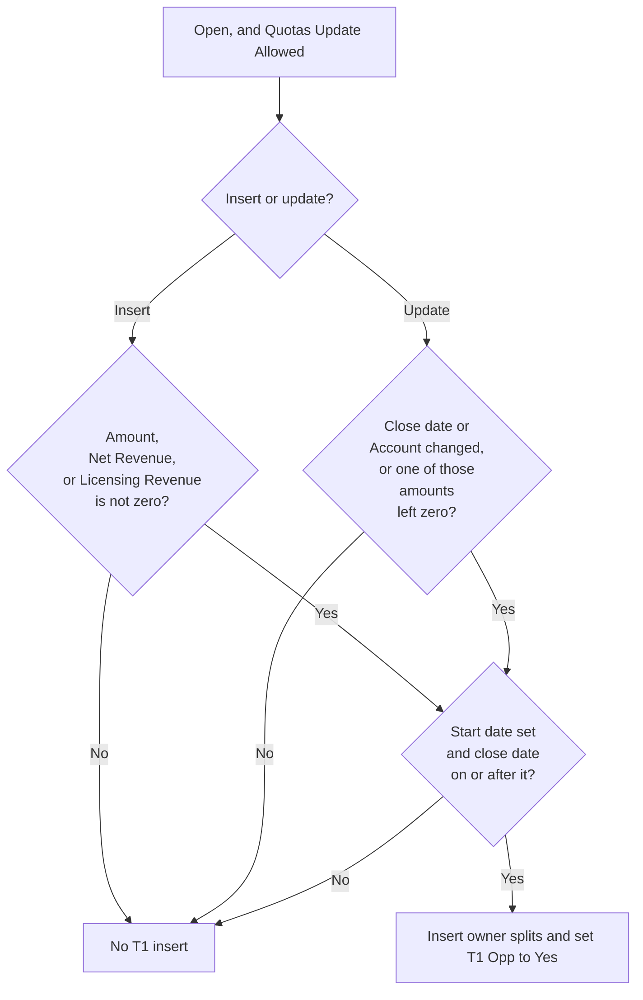

This runs only when the Opportunity is open and Quotas Update Allowed is true.

On insert, T1 is considered when any of these is not null and not zero: `Amount`, `Net_Revenue_Forecast__c` (Net Revenue), `Estimate_Licensing_Revenue__c` (Estimate: Licensing Revenue).

On update, T1 is considered when the close date changed, the Account changed, or one of those three amounts moved from null or zero to a non-zero value. An update that only changes an amount that was already non-zero does not take this path.

Splits are inserted only when the Account has a T1 start date and `CloseDate` is on or after that date. The Opportunity owner gets a T1 split. The Account owner gets one too when that user is different. If `T1_Opp__c` is not already `Yes`, the engine sets it to `Yes`.

### Close date outside the window

Setting `T1_Opp__c` to No waits for the close date or the Account to change. Deleting an existing T1 split that is outside the window does not.

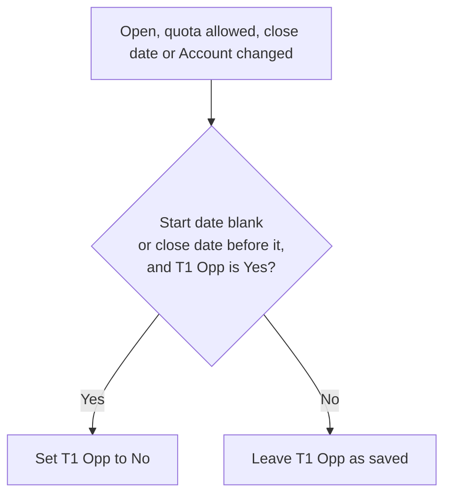

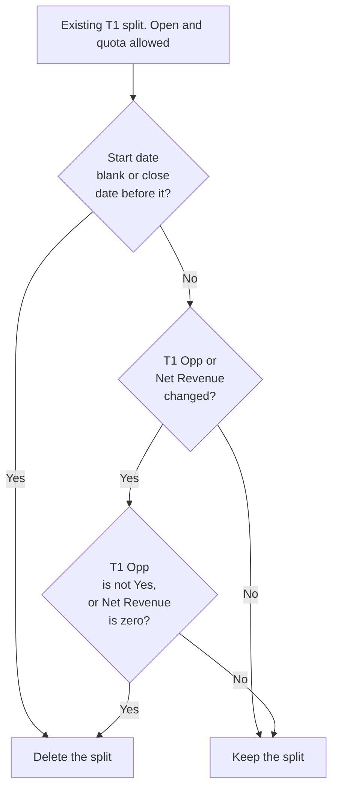

When an open, quota-allowed Opportunity is updated and the close date or Account changed:

- If the T1 start date is blank, or the close date is before it, and `T1_Opp__c` is `Yes`, the engine sets `T1_Opp__c` to `No`.

Separately, on every open, quota-allowed update, existing T1 splits are deleted when the T1 start date is blank or the close date is before it. That deletion does not wait for the close date to have changed on this save.

T1 splits are also deleted when `T1_Opp__c` or Net Revenue changed on this save, and the Opportunity is not `T1_Opp__c = Yes` or Net Revenue is null or zero.

### T1 eligibility reconciliation

This pass does not set `T1_Opp__c` back to No, and it does not look at `IsClosed`.

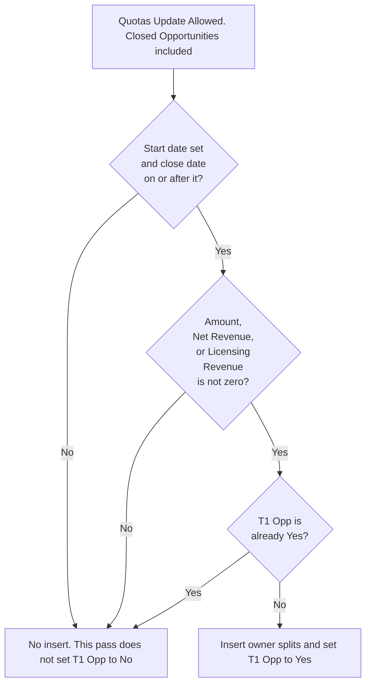

This runs on insert and update whenever Quotas Update Allowed is true, including when the Opportunity is closed. It does not require a particular field to have changed.

The Opportunity is treated as eligible when all of these are true:

- The Account has a T1 start date.
- Close date is set and is on or after that start date.
- `Amount`, Net Revenue, or Estimate: Licensing Revenue is not null and not zero.

If it is eligible and `T1_Opp__c` is not `Yes`, the engine inserts the standard T1 splits and sets `T1_Opp__c` to `Yes`. It does not set the flag back to `No`. That is the close-date gate above, and that gate does not run on a closed Opportunity.

This path exists so a rollup that lands after the Opportunity has closed can still create the T1 split. The normal assignment pass does not run on closed Opportunities, and Run Splits Flow only recreates T1 when `T1_Opp__c` is already `Yes`.

---

## T2

Open Opportunity, Quotas Update Allowed true. An insert does not need a field change. An update does.

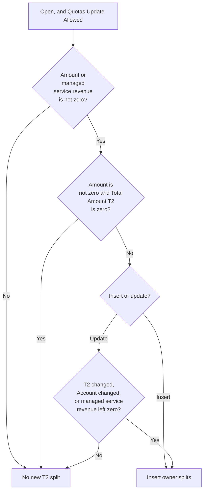

Deletion does not wait for `Total_Amount_T2__c` to change on this save.

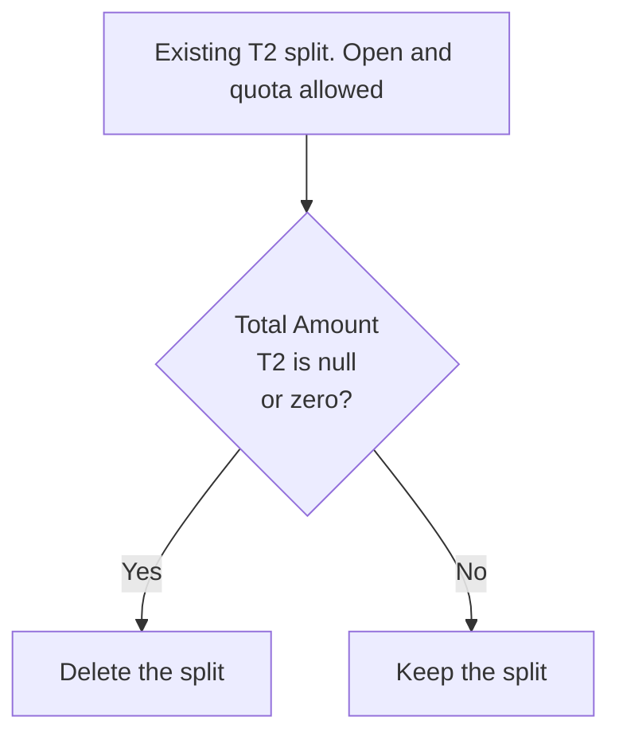

T2 is skipped unless there is service revenue: `Amount` is not null and not zero, or `Estimate_Managed_Service_Revenue__c` (Estimate: Managed Service Revenue) is not null and not zero. If `Amount` is non-zero, `Total_Amount_T2__c` must also be non-zero. Estimate: Consulting Revenue is not part of this check.

On insert, that is enough to add the standard T2 splits.

On update, one of these must also be true: `Total_Amount_T2__c` changed, the Account changed, or Managed Service Revenue moved from null or zero to a non-zero value.

Existing T2 splits are deleted on every open, quota-allowed update when `Total_Amount_T2__c` is null or zero. The deletion pass does not require the amount to have changed on this save.

---

## T3

Open Opportunity, Quotas Update Allowed true. A product change can insert a split even when `Total_Amount_T3__c` is zero. The deletion pass then removes existing T3 splits and leaves the insert queued in this run.

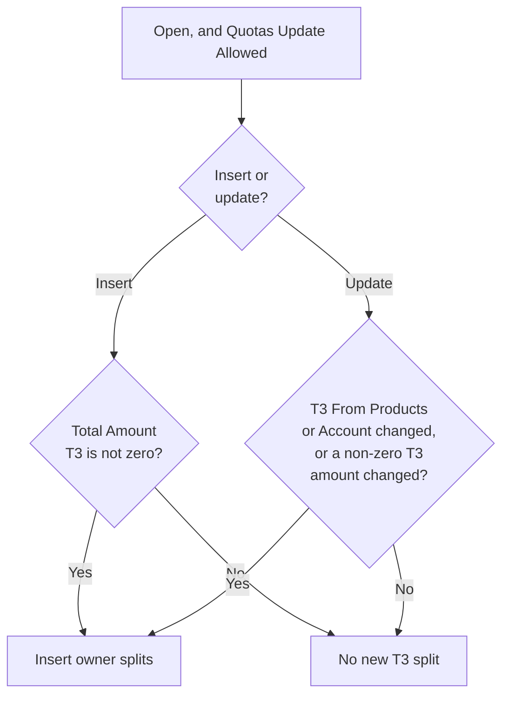

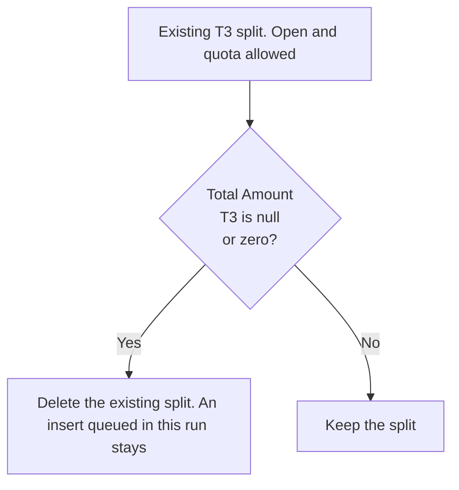

On insert, T3 splits are added when `Total_Amount_T3__c` is not null and not zero.

On update, T3 is considered when `T3_From_Products__c` changed, or the Account changed, or `Total_Amount_T3__c` is non-zero and that amount changed. A change to `T3_From_Products__c` takes this path even when `Total_Amount_T3__c` is null or zero, and the engine still inserts the owner splits. The deletion pass then removes **existing** T3 splits because the amount is zero. Splits queued for insert in the same run are not in that delete list.

Existing T3 splits are deleted on every open, quota-allowed update when `Total_Amount_T3__c` is null or zero.

---

## Owner change and cleanup

The first diagram runs only when the owner changes. The second runs on every open, quota-allowed update, before the T1, T2, and T3 deletion rules.

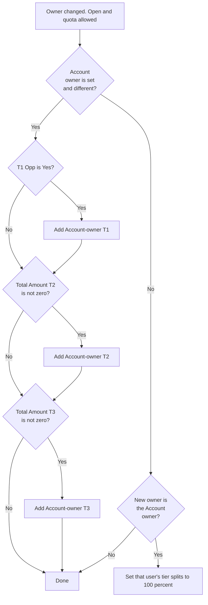

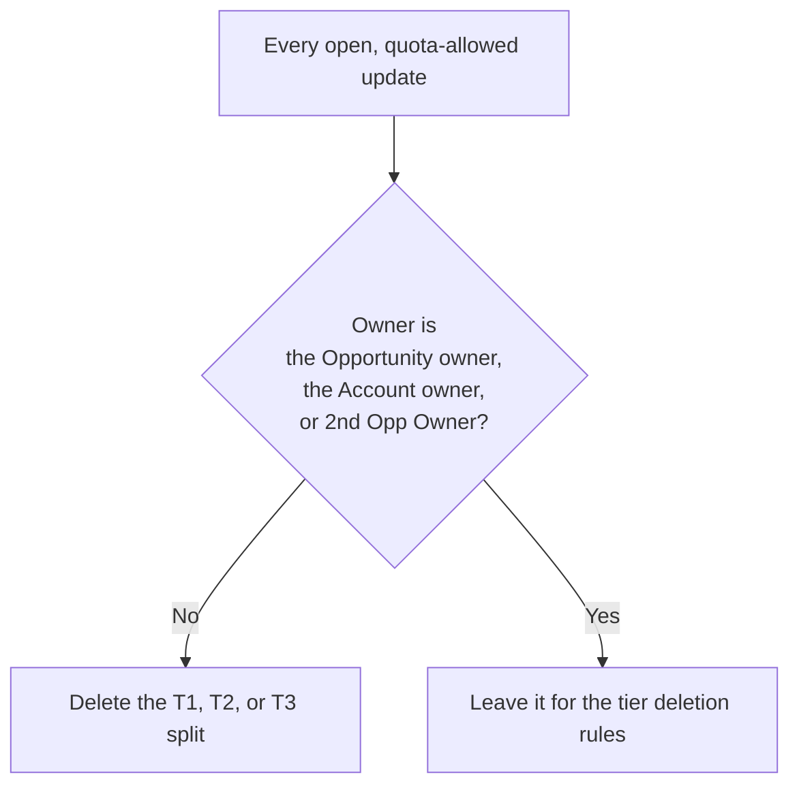

When the Opportunity owner changes, the Opportunity is open, and Quotas Update Allowed is true:

- If the Account owner is set and is not the new Opportunity owner, the engine adds a split for the Account owner on each tier the Opportunity still qualifies for: T1 when `T1_Opp__c` is `Yes`, T2 when `Total_Amount_T2__c` is non-zero, T3 when `Total_Amount_T3__c` is non-zero.
- If the new Opportunity owner is the Account owner, existing T1/T2/T3 splits owned by that user with a percentage other than 100 are updated to 100.

On every open, quota-allowed update, a T1/T2/T3 split is deleted when its owner is not the Opportunity owner, not the Account owner, and not `Second_opp_owner__c`.

---

## Run Splits Flow

Checking `Run_Splits_Flow__c` (label **Run Splits Flow**) runs an admin repair, including on a closed Opportunity. It runs when the checkbox is true and the previous value was not true. Insert counts as a change from blank.

For each tier that qualifies, it inserts the Opportunity owner and, when different, the Account owner:

| Tier | Qualifies when |
| --- | --- |
| T1 | `T1_Opp__c` is `Yes`. The T1 start date is not checked. |
| T2 | `Total_Amount_T2__c` is not null and not zero |
| T3 | `Total_Amount_T3__c` is not null and not zero |

The engine then sets `Run_Splits_Flow__c` back to false. Repair does not delete splits.

---

## Quotas Update Allowed

`Quota_Update_Allowed__c` is a formula, label **Quotas Update Allowed**. The engine treats it as the switch for assignment, reconciliation, and deletion. Run Splits Flow does not read it.

The formula is true when the stage is Explore, Identify Needs, Develop Solution, Evaluate, Justify, or Closing.

It is also true for **Closed won - awaiting approval** and **Order** when the close date is in the current calendar quarter and the current calendar year.

It is also true for **Closed Lost**, **Duplicate - Error in Opp**, **Duplicate - Multiple Options**, **Duplicate - Dead Quote**, and **Cancelled After Invoice** when the close date is after `TODAY() - 90`.

Pipeline stages in the diagram are Explore, Identify Needs, Develop Solution, Evaluate, Justify, and Closing.

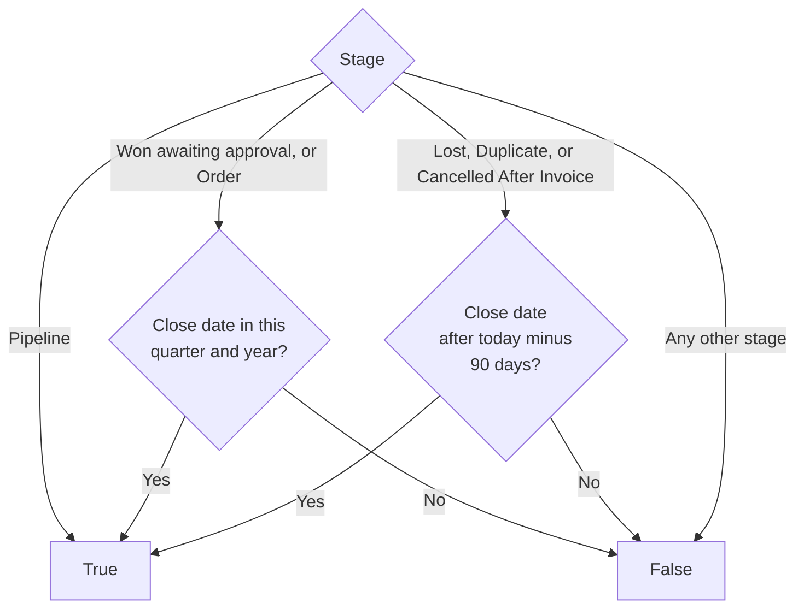

`IsClosed` is a separate check. A closed Opportunity can have Quotas Update Allowed true and still skip assignment and deletion. Reconciliation and Run Splits Flow are the exceptions described above.

---

## Screen flow

`ScreenFlow_Add_to_T1_T2_T3_Splits` (label **ScreenFlow Add to T1 T2 T3 Splits**) is **Active**. It is a screen flow, not a record-triggered flow. It does not check `Automation_Enabled__c`, Quotas Update Allowed, or `IsClosed`.

The user picks a user. The flow then creates a 100% `OpportunitySplit` for that user when the tier applies and that user does not already have that split type on the Opportunity:

| Tier | Created when |
| --- | --- |
| T1 | `T1_Opp__c` is `Yes` |
| T2 | `Total_Amount_T2__c` is not null and not zero |
| T3 | `Total_Amount_T3__c` is not null and not zero |

The three `SplitTypeId` values are hardcoded ids in the flow (`149P5000001tntxIAA`, `149P5000001gAiLIAU`, `149P5000001gAnBIAU`). The engine looks up types by the labels T1, T2, and T3. The screen flow does not.

---

## Flows that are still active

These do not insert the standard owner splits. They keep the dates and amounts that the engine reads.

| Flow | Status | What it still does |
| --- | --- | --- |
| `T1_Start_date_updates_Parent_child_account_relationship` | Active | On Account update, UK or US, when automation is on and `T1_Start_Date__c` or `ParentId` changed. Copies the T1 start date onto child Accounts, or onto an Account that has no start date when its parent changes. |
| `T2_Amount_Calculation_Launch_Roll_Ups` | Active | After save on Opportunity Product, UK or US, automation on, Quotas Update Allowed, and a price, date, discount, renewal, or revenue-type change. Writes `T2_Attainment_Amount__c` on the product. |
| `Calculate_T2_Amount_Roll_Up_from_Opportunity` | Active | Autolaunched. Same product-level T2 attainment calculation. Called by the two project flows below. |
| `T2_Amount_when_Project_is_added_changed` | Active | Opportunity update, UK or US, when `Related_Project__c` changes and quota updates are allowed. Calls the T2 attainment flow. |
| `T2_Amount_when_Project_Start_Date_is_changed` | Active | `Project__c` update, UK or US, when `Project_Start_Date_new__c` changes. Calls the T2 attainment flow. |
| `T3_Override_set_to_false` | Active | Opportunity update, UK or US, automation on. `doesRequireRecordChangedToMeetCriteria` is true, and the formula requires `T3_Override__c = false`. Calls `T3_Roll_Up`. |
| `T3_Roll_Up` | Active | Autolaunched. For UK or US (`Opportunity.CV_Subsiduary__c`), when T3 Override is false, sums `Margin_Value__c` on products with `T3_Product__c` and writes `T3_From_Products__c`. |
| `T3_Roll_Up_Product_Deleted` | Active | Autolaunched variant for a deleted product. No active record-triggered flow calls it. The flow that used to call it is Obsolete. |
| `T2_T3_Roll_Ups_when_product_is_deleted` | Active | Autolaunched. Same situation: the before-delete flow that called it is Obsolete. |

`T2_Override_set_to_false` is Obsolete. Unchecking T2 Override does not launch a flow. [Tier calculation](Tier_Calculation.md) still recalculates `Total_Amount_T2__c` when that checkbox is false.

---

## Obsolete split flows

These are in the repo with status **Obsolete**. They do not run. The engine replaced them.

| Flow | What it used to do |
| --- | --- |
| `Assign_T2_Splits_at_Opportunity_Creation_and_change_of_T2_Amount` | T2 splits on create and when the T2 amount changed |
| `Assign_T3_Splits_at_Opportunity_Creation_and_change_of_T3_Amount` | T3 splits on create and when the T3 amount changed |
| `Create_All_Splits_T1_T2_T3` | All three tiers when Run Splits Flow was checked |
| `Delete_Splits_At_Modification_of_the_opportunity` | Delete splits when the Opportunity changed |
| `Delete_Splits_when_account_owner_is_changed` | Delete splits when the Account owner changed |
| `Delete_Split_0` | Delete a zero split |
| `Update_Splits_when_owner_is_changed` | Rebuild splits when the Opportunity owner changed |
| `T1_Opp_Yes_from_Opportunity` | Set T1 Opp to Yes from the close date and Account |
| `T1_Opp_Yes_from_Account` | Set T1 Opp to Yes when the Account T1 start date changed |
| `T1_Opp_No_when_account_is_changed` | Set T1 Opp to No when the Account changed |
| `T1_T2_T3_Fix_200_Splits` | Scheduled daily repair of splits at 100% |

`Update_T1_Start_Date` is a one-time scheduled Account flow and is also Obsolete.
