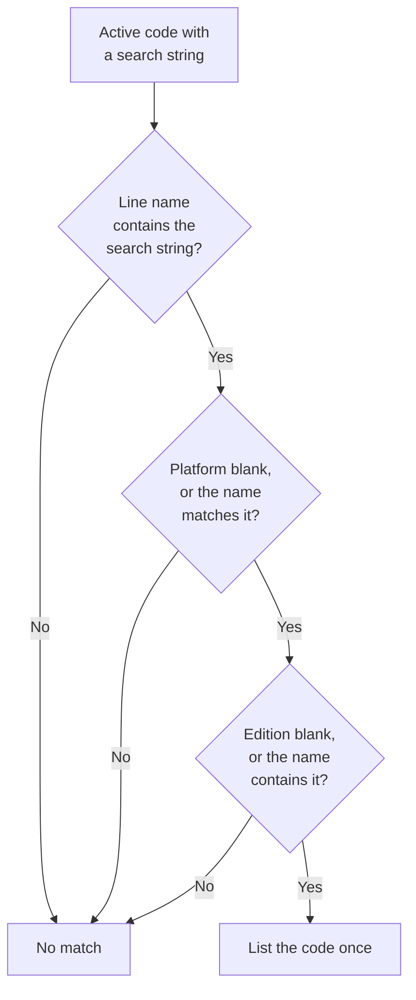

# Promotion codes

`PromotionCode__c` stores marketplace promo codes that vendors give Eficode. When someone fetches an Atlassian quote on an Opportunity, the quote importer lists the codes that match products on that quote. The user applies the code in Atlassian. Salesforce does not write the code onto the Opportunity or change the imported prices.

Invoice import and the JSON quote upload do not show promo codes.

---

## Table of Contents

1. [Where it appears](#where-it-appears)
2. [Fields](#fields)
3. [How a quote line matches](#how-a-quote-line-matches)
4. [How to add a code](#how-to-add-a-code)

---

## Where it appears

The Lightning component is `partnerPortalApiQuoteImporter` (Atlassian PPC Quotes on the Opportunity). After **Fetch Quote** succeeds, `PromoCodeMatcher.getMatchingPromoCodes` runs on the fetched quote.

The screen shows a card titled **Available Promo Codes**:

| On the card | Source |
| --- | --- |
| Product | The quote line name that matched |
| Promo Code | `PromoCode__c`. If `CodeUrl__c` is set, the code is a link that opens in a new tab |
| Partner | `Partner__c`, when filled |
| Valid | `StartDate__c` and, when set, `EndDate__c` |
| Info | `ShortInfo__c`, when filled |

Each code is listed once, even when several lines match it. If nothing matches, the card says no promo codes were found for the products in this quote. A matcher error leaves the card empty and does not block import.

`partnerPortalApiInvoiceImporter` and `partnerPortalJsonImporter` do not call the matcher.

`PromoCodeController.getActivePromoCodes` can list active codes, optionally filtered by partner name. No Lightning component calls it. The quote screen uses `PromoCodeMatcher` only.

---

## Fields

Object label: **Promotion Code**. Sharing is Read/Write. The list view **All** shows the fields below.

| Field | Label | Role |
| --- | --- | --- |
| `Name` | Promotion Code Name | Record name. Not used in matching. |
| `PromoCode__c` | Promo Code | The code text, unique. This is what the user copies into Atlassian. |
| `Partner__c` | Partner | Vendor name, shown on the card. Not used in matching. |
| `SearchString__c` | Search String | Required keyword. The quote line must contain this text. |
| `Platform__c` | Platform | Optional. Cloud, Datacenter, or Services. |
| `Edition__c` | Edition | Optional. Standard or Premium. |
| `ShortInfo__c` | Short Info | Extra text on the card. |
| `CodeUrl__c` | Code URL | Optional link, for example a `promo.atlassian.com` page. |
| `StartDate__c` | Start Date | Required. Defaults to today. |
| `EndDate__c` | End Date | Blank means the code does not expire. |
| `IsActive__c` | Is Active | Formula. True when the start date is today or earlier, and the end date is blank or today or later. |

The search-string help text says the keyword is compared to `Product2.Name`. The matcher does not do that. It compares the keyword to the quote line.

---

## How a quote line matches

`PromoCodeMatcher` loads rows where `IsActive__c` is true and `SearchString__c` is not blank. Expired codes drop out because of the formula. No separate date filter runs in the query.

For each upcoming-bill line it uses `productName` when that is filled, otherwise `description`.

The card lists each matching code once. The user applies it in Atlassian. Imported prices stay unchanged. Invoice import and the JSON upload do not show the card.

A code matches that line when all of these are true:

1. The line name contains `SearchString__c`. The check ignores case.
2. Platform is blank, or the line name satisfies the platform rule:
   - **Cloud** — the name contains `cloud`
   - **Datacenter** — the name contains `datacenter` or `data center`
   - **Services** — the name contains `service`
3. Edition is blank, or the line name contains `Standard` or `Premium`, ignoring case.

Example: search string `ScriptRunner`, platform Cloud, edition blank. A line named `ScriptRunner for Jira Cloud` matches. `ScriptRunner for Jira Data Center` does not, because the platform filter requires `cloud`.

This is separate from `PpcProductToSalesforceMapping__mdt`. A promo can match a line that later maps to a different Salesforce product, and a mapped product does not by itself surface a promo.

---

## How to add a code

1. Create a **Promotion Code**.
2. Set **Promo Code** to the value the user must enter in Atlassian.
3. Set **Search String** to a word that appears in the Atlassian quote line name, such as the marketplace app name.
4. Set **Platform** and **Edition** only when the code is limited to that variant. Leave them blank to match any line that contains the search string.
5. Set **Start Date**. Set **End Date** when the vendor's code expires. Leave end date blank if it should stay active.
6. Put the vendor in **Partner**, a one-line note in **Short Info**, and the vendor URL in **Code URL** when you have one.

The next quote fetch picks the row up as soon as `IsActive__c` is true. Nothing has to be deployed. Deactivate a code by moving **End Date** to yesterday, or **Start Date** to the future.
