# Quote and invoice import

Sales users turn an Atlassian partner-portal quote or invoice into Opportunity Products. There are three Lightning components on the Opportunity, and one invoice list on the Account.

Invoice Groups must already be linked to the Account before Account invoice lists or invoice fetch by billing profile will return data. See [Invoice groups](Invoice_Groups.md). Credential lookup and the two product-mapping tables are below. A short index of the same metadata is in [Atlassian PPC overview](Atlassian_PPC_Overview.md#configuration).

---

## Table of Contents

1. [Where the components sit](#where-the-components-sit)
2. [Which credential is used](#which-credential-is-used)
3. [Product mapping](#product-mapping)
4. [JSON quote upload](#json-quote-upload)
5. [Commerce API quote import](#commerce-api-quote-import)
6. [Commerce API invoice import](#commerce-api-invoice-import)
7. [Invoices on the Account](#invoices-on-the-account)
8. [Field mapping](#field-mapping)
9. [Merging line items](#merging-line-items)
10. [Price book entries](#price-book-entries)

---

## Where the components sit

| UI label in the design notes | Component | Record page |
| --- | --- | --- |
| Atlassian Quotes | `partnerPortalJsonImporter` | Opportunity |
| Atlassian PPC Quotes | `partnerPortalApiQuoteImporter` | Opportunity |
| Atlassian PPC Invoices | `partnerPortalApiInvoiceImporter` | Opportunity |
| Atlassian PPC Invoices | `partnerPortalApiInvoiceViewer` | Account |

The Account viewer reads every **active** Invoice Group on the Account and requests invoices for each one, using the named credential for `Account.CV_Subsidiary__c`.

---

## Which credential is used

Commerce API quote import, invoice import, and the Account invoice list call Atlassian with the credential for the Opportunity's or Account's subsidiary.

`PortalCommerceApiAccessMgmt` reads `PPC_TransactionAccount__mdt`:

| Piece | Where it is stored |
| --- | --- |
| Account subsidiary API value | `SubsidiaryApiName__c`. This must equal `Account.CV_Subsidiary__c`. Jodocus is the exception: the API value is `Jodocus GmbH`, and the developer name is `JODOCUS`. |
| Named credential | `Eficode_Office_` plus the custom metadata **developer name** (`FI`, `SE`, `UK`, `JODOCUS`, …). |
| Transaction account UUID | The custom metadata **label**. It is sent as the `X-transaction-account` header. The named credential username is the same UUID. |
| API token | Named credential password. |

Offices in the repo: CH, DE, DK, FI, JODOCUS, NL, NO, SE, UK, US. `PortalCommerceApiClient` also requires the custom permission `Eficode_Office_{CODE}` for the running user. A manual import uses the user who clicks the button. The monthly job uses the user who scheduled `PpcInvoiceImporterBatch`, and that user needs the permission for every subsidiary it imports.

The JSON file upload never calls PPC. It does not read `PPC_TransactionAccount__mdt`.

---

## Product mapping

Atlassian line items become Salesforce `Product2` records through custom metadata. The two tables are separate. A product added to one table is invisible to the other import path.

| Path | Custom metadata | Mapper | What is matched |
| --- | --- | --- | --- |
| JSON quote file | `PortalProductToSalesforceMapping__mdt` | `PortalProductMapper` | `productName`, `platform`, and `edition` from the JSON line |
| Commerce API quote | `PpcProductToSalesforceMapping__mdt` | `PpcPortalProductMapper` | Quote bill line `description` |
| Commerce API invoice, including the monthly job | `PpcProductToSalesforceMapping__mdt` | `PpcPortalProductMapper` | Invoice line `description` |

Comparisons are case-sensitive (`==`). `SalesforceProductName__c` must equal `Product2.Name`. After the product is found, the Opportunity still needs a price book entry in its price book and currency. See [Price book entries](#price-book-entries).

If `SalesforceProductName__c` contains the text `null` (any case), the mapper treats it as no Salesforce product.

### JSON file — `PortalProductToSalesforceMapping__mdt`

Setup label: **Portal Product To Salesforce Mapping**. Read only by the JSON upload (`OpportunityProductMapper` → `PortalProductMapper.mapProduct`).

| Field | How it is used |
| --- | --- |
| `ProductName__c` | Partner portal product name, spelled as in the JSON `productName`. Blank on the two default rows. |
| `Platform__c` | JSON `platform`, spelled the same way. The shipped defaults use `CLOUD` and `DATACENTER`. |
| `Edition__c` | JSON `edition`. Blank when the JSON edition is null. |
| `SalesforceProductName__c` | `Product2.Name` to use. The text `null` means this row does not create an Opportunity Product. |
| `ZeroSEN__c` | When true, that line's support entitlement number is forced to `0` before the Opportunity Product is built. |

Rows shipped for the special cases:

| Record | Product name | Platform | Edition | Salesforce product | What it does |
| --- | --- | --- | --- | --- | --- |
| `Default_001` | blank | `CLOUD` | blank | Atlassian Cloud - Marketplace Application | Fallback when a CLOUD line has no exact match |
| `Default_002` | blank | `DATACENTER` | blank | Atlassian Data Center - Marketplace Application | Fallback when a Data Center line has no exact match |
| `Entitlement_001` | `Atlassian Cloud` | `CLOUD` | blank | the text `null` | Reads the SEN off the Atlassian Cloud JSON line and does not create a product |

`PortalProductMapper.mapProduct` then does this. A single match on product name alone is discarded. The platform default is used instead.

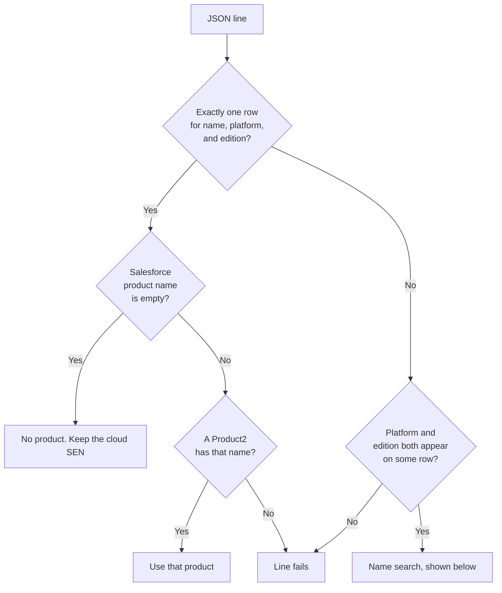

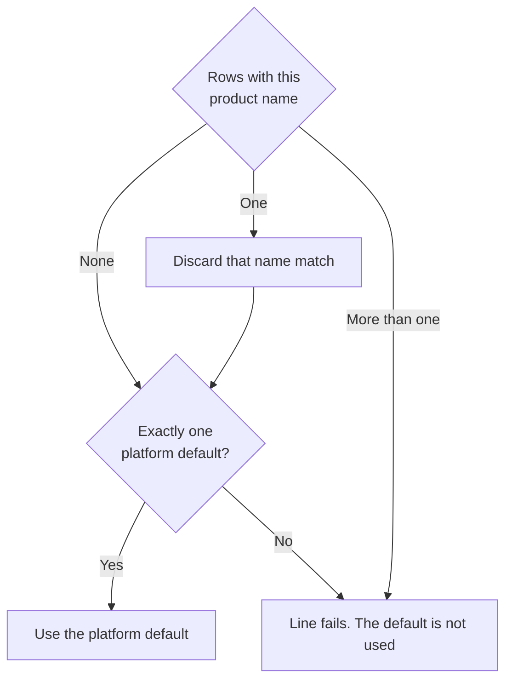

1. Look for one row where product name, platform, and edition all equal the JSON line, including blanks.
   - One row whose Salesforce product name is empty (`Entitlement_001` is this case): do not create an Opportunity Product. Keep that line's `supportEntitlementNumber` as the shared cloud SEN. Later CLOUD lines whose SEN is not `0` get `SEN__c` set to that value.
   - One row with a real Salesforce product name: use that `Product2`. If `ZeroSEN__c` is checked, set this line's SEN to `0` so the shared cloud SEN is not copied onto it.
   - One row, but no `Product2` with that name: the line fails (`found = false`).
2. If that triple is not exactly one row, both the platform and the edition must already appear on some row in the table. A platform or edition that has never been used on any row stops the line. The default row is not used.
3. Otherwise search by product name only:
   - No row has that product name: use the platform default (blank product name, blank edition, this platform) when exactly one such row exists.
   - Exactly one row has that product name, but platform or edition differed: that name match is discarded. The platform default is used instead.
   - More than one row has that product name: the line fails. The platform default is not used.

Add a new JSON product by creating a custom metadata record with the JSON `productName`, `platform`, and `edition` copied exactly, and `SalesforceProductName__c` set to an existing `Product2.Name`. Check `ZeroSEN__c` only when that product must keep SEN `0`.

### Commerce API — `PpcProductToSalesforceMapping__mdt`

Setup label: **PPC Product To Salesforce Mapping**. Read by manual quote import, manual invoice import, and [monthly invoice auto-import](Monthly_Invoice_Auto_Import.md). Class: `PpcPortalProductMapper.mapProduct`.

| Field | How it is used |
| --- | --- |
| `ProductName__c` | Match key. Blank on the default row. |
| `SalesforceProductName__c` | `Product2.Name` to use. |

The search key is the line **description** with everything from the first `(` removed, then trimmed.

`Jira, Premium, Annual (USD, Default, 29-03-2024)` matches a row whose `ProductName__c` is `Jira, Premium, Annual`.

`PpcPortalProductMapper.mapProduct` then does this. An unknown description stays `found = true` and uses the default product. `found = false` means duplicate rows for that name, or a Salesforce product name stored as the text `null`.

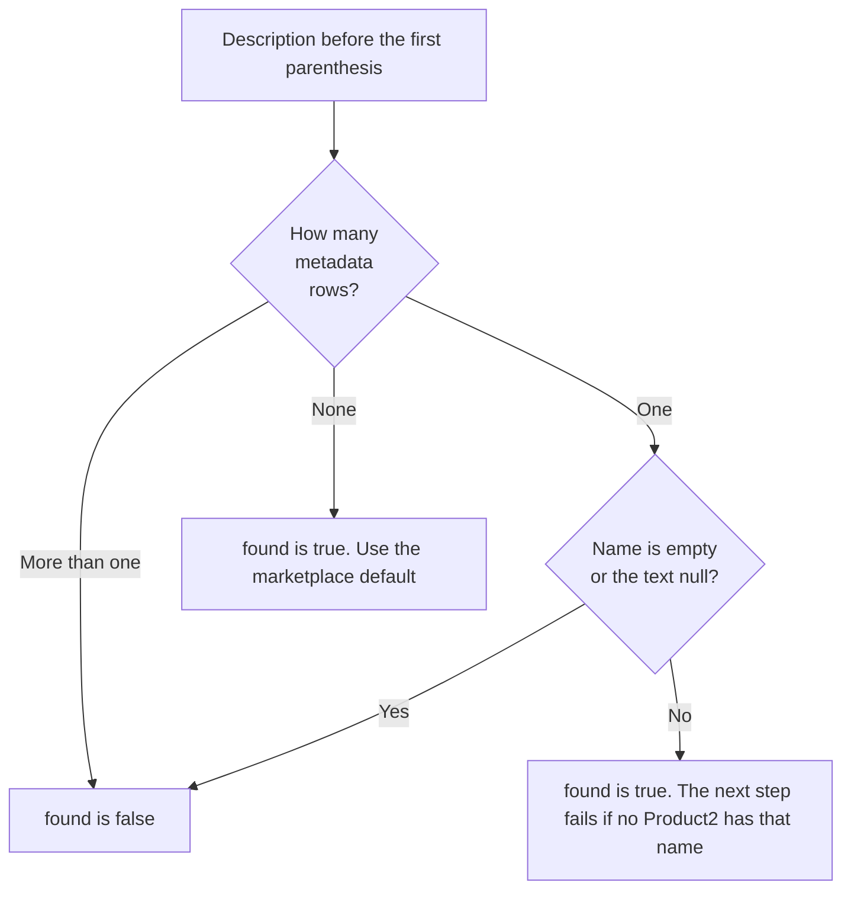

1. Exactly one row with that product name: look up `Product2` by `SalesforceProductName__c`. `found` is set to true when the metadata name is non-empty, including when no `Product2` has that name. The next step then fails because the product id is missing. Keep `SalesforceProductName__c` identical to `Product2.Name`.
2. No row with that product name: `found` is still true. The line uses the default row, the one with a blank `ProductName__c`. In this repo that is `Default_001`, Salesforce product **Atlassian Cloud - Marketplace Application**. The log text says the product name is unknown, and the line is still mapped.
3. More than one row with the same `ProductName__c`: `found` is false. The default product is not used.

So an unmapped Commerce API description does not show up as `found=false`. It becomes the marketplace-application product. `found=false` means duplicate metadata rows for that name, or a metadata row whose Salesforce product name was stored as the text `null`.

Quote lines pass `upcomingBills.lines[].description`. Invoice lines pass `items[].description`. The monthly job calls `PpcOpportunityProductMapper.mapProducts` on the invoice with merging turned on, which uses this same lookup.

Add a Commerce API product by creating a record whose `ProductName__c` is the description before `(`, and whose `SalesforceProductName__c` is an existing `Product2.Name`. Leave product name blank only on the single default row.

---

## JSON quote upload

This path uses a JSON file exported from the older portal. The file holds the order, the line items, and the technical contact.

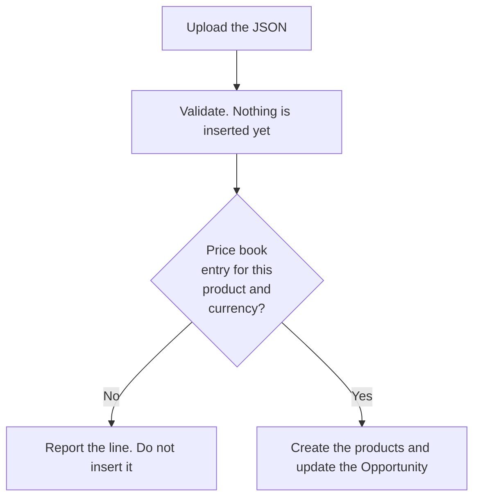

1. Upload the file, or drop it on the component.
2. Click **Validate Opportunity Products**. This maps lines to Opportunity Products and shows the result. Nothing is inserted yet.
3. In **Pricebook Entries**, confirm each product is FOUND. A missing row means the price book has no entry for that product and currency.
4. Review **Success** for the field values that will be written.
5. Click **CREATE Opportunity Products!** to insert the lines and update the Opportunity.

On create, `PortalQuoteConverter` inserts the lines immediately and sets:

- `Atlassian_AT_Quote_ref__c` to the portal order number
- `Atlassian_AT_Quote_amount__c` to the total excluding tax
- `AT_quote_expiry__c` to the due date
- `QuoteImportResult__c` to the conversion log
- `Atlassian_AT_Quote_Tech_Contact__c` to an existing Contact on the Account with that email, or a new Contact created from the technical contact on the file

Lines with `unitPrice` of 0 are skipped.

---

## Commerce API quote import

1. Paste the Atlassian Partner Portal quote URL.
2. Click **Fetch Quote**. The component loads the quote through the Commerce API and shows the JSON.
3. **Preview PDF** opens the Atlassian quote PDF in a new browser tab. See [Quote and invoice PDF preview](Quote_And_Invoice_PDF_Preview.md).
4. Click **Import fetched Quote** to map lines and show conversion results. An unknown description still has `found=true` and uses the default Salesforce product. `found=false` means the metadata matched more than one row. See [Commerce API — `PpcProductToSalesforceMapping__mdt`](#commerce-api--ppcproducttosalesforcemapping__mdt).
5. Review **Oppty Lines**, **Error Log**, and **Success Log**.
6. Click **Import fetched Quote and create products!** `PpcQuoteConverter` creates a `PendingInvoice__c` in status **Processing**, sets `ImportedInvoiceNumber__c` to the quote number, and enqueues `ProcessOpportunityLinesQueueable` to insert the lines (up to 90 per execution). The Opportunity stays on its current stage.

**Merge Line Items** is on by default. See [Merging line items](#merging-line-items).

On create, the Opportunity is also updated with:

- `Atlassian_AT_Quote_ref__c` = quote number
- `Atlassian_AT_Quote_amount__c` = upcoming bill `subTotal / 100`
- `AT_quote_expiry__c` = quote `expiresAt`
- `PpcQuoteImportResult__c` = the conversion log

Quote money fields from the API are in minor units. The mapper divides `amountExcludingTax` and `subTotal` by 100 before writing Opportunity Product prices.

An open quote is completed from the order preview. An accepted quote is completed from its orders. Entitlement name, slug, and ARI come from per-line entitlement calls. The API response does not include a technical contact, so this path does not set `Atlassian_AT_Quote_Tech_Contact__c`.

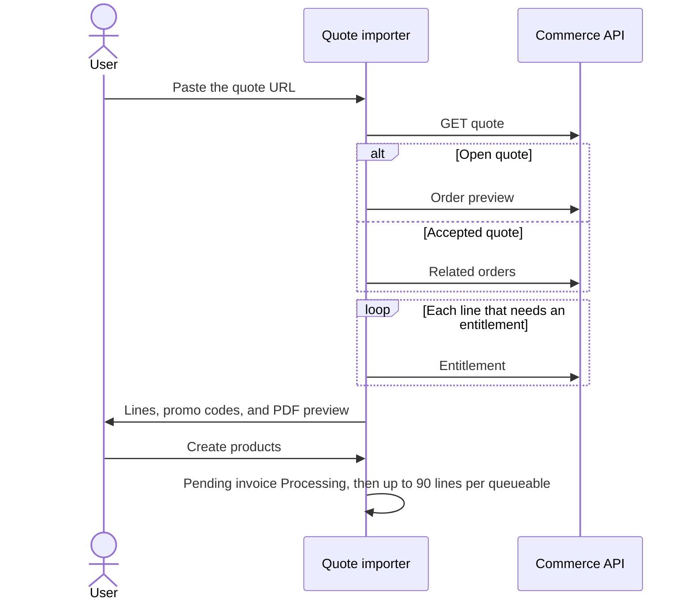

Invoice import uses the same queueable. When its lines are in, the Opportunity stage is set to **Closing**. A quote leaves the stage unchanged.

After the quote is fetched, the same screen lists **Available Promo Codes** that match line names. That list is a reminder. Applying a code is done in Atlassian. See [Promotion codes](Promotion_Codes.md). Invoice import does not show this list.

---

## Commerce API invoice import

This is the **Atlassian PPC Invoices** tab on the Opportunity (`partnerPortalApiInvoiceImporter`). The card title is **Import Atlassian Partner Portal Invoice via API into Salesforce Opportunity Products**. It writes products onto an Opportunity that already exists. It does not create the Opportunity.

The Account tab with the same name only lists invoices. Copy the invoice id from there, or paste the full invoice URL. See [Invoices on the Account](#invoices-on-the-account).

**Merge Line Items** is checked by default. Leave it checked to collapse lines that share a PPC line id and the same start and end. See [Merging line items](#merging-line-items).

### 1. The tab opens

Paste the invoice URL or id into **Atlassian Partner Portal Invoice URL**. **Fetch Invoice** is the only button that can be used. The two import buttons stay disabled, and both result areas are empty. Nothing has been read from Atlassian, and nothing is written to the Opportunity.

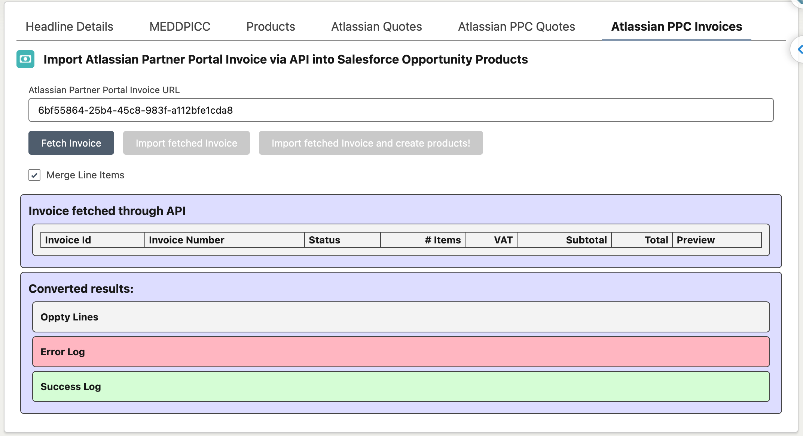

The id in this shot is the same invoice as the Account list, `6bf55864-25b4-45c8-983f-a112bfe1cda8`.

### 2. Fetch Invoice

**Fetch Invoice** loads the invoice and its lines. The header shows the invoice number, status, item count, VAT, subtotal, and total. The lines underneath show description, entitlement number, dates, quantity, and amounts. The result logs stay empty. Fetch does not map products and does not insert them.

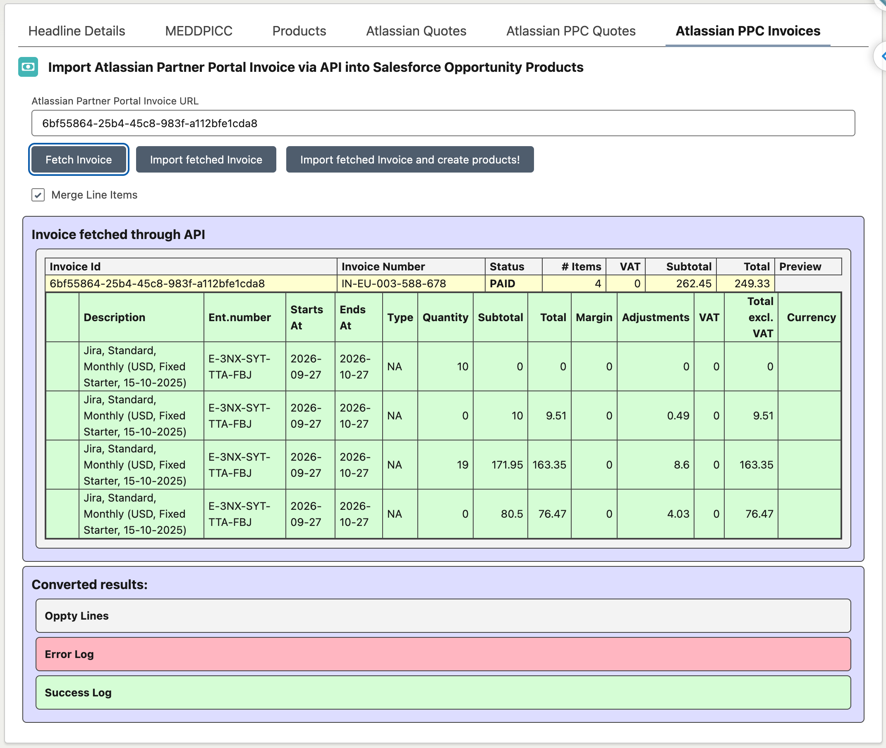

This fetch returns invoice `IN-EU-003-588-678`, status PAID, with four lines. **Import fetched Invoice** and **Import fetched Invoice and create products!** are now enabled.

### 3. Import fetched Invoice

**Import fetched Invoice** maps the lines and shows the result. It still does not insert Opportunity Products.

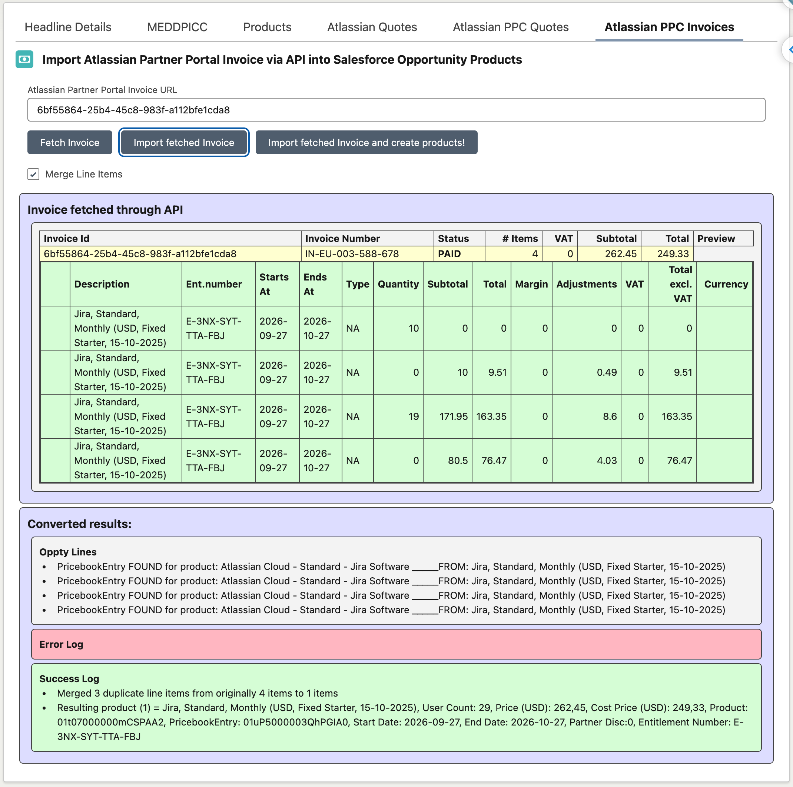

Read the three logs before creating anything:

- **Oppty Lines** lists each source line and whether a price book entry was found for the mapped product and the Opportunity currency.
- **Error Log** is empty when every line mapped. A line here is not safe to create.
- **Success Log** is what will be written. With **Merge Line Items** checked, these four Jira lines become one product: user count 29, dates 2026-09-27 to 2026-10-27, entitlement `E-3NX-SYT-TTA-FBJ`.

Stop here if the Error Log has a line, or if the Success Log is not the product you expect. Nothing is on the Opportunity yet.

### 4. Import fetched Invoice and create products!

Click **Import fetched Invoice and create products!** This is the last step, and the only click that writes.

A success toast says the invoice was imported and the products are queued for creation. `PpcInvoiceConverter` then:

- Creates a `PendingInvoice__c` for this invoice, status **Processing**, linked to the Opportunity and its Account. The line count is the merged count from the Success Log (one product in this example).
- Sets `ImportedInvoiceNumber__c` to the invoice number.
- Enqueues `ProcessOpportunityLinesQueueable`, which inserts the Opportunity Products. When those lines are in, the Opportunity stage is set to **Closing**. A quote import uses the same queueable and leaves the stage unchanged.

The Opportunity is also updated with:

- `Atlassian_AT_Quote_ref__c` = invoice number
- `Atlassian_AT_Quote_amount__c` = invoice `subTotal`
- `AT_quote_expiry__c` = invoice `dueAt`
- `PpcQuoteImportResult__c` = the conversion log

Invoice list price (`Editable_Unit_List_Price_in_USD__c`) is the API `subTotal` as returned. Cost (`Editable_Cost_Price_in_Dollars__c`) is `total` minus `tax`. Partner discount is the sum of margin amounts. Price adjustment is the sum of adjustment amounts.

Each invoice line is filled from the related order and order item, then from entitlement partner info (`provisionedResource.name` becomes the cloud site name).

---

## Invoices on the Account

`partnerPortalApiInvoiceViewer` lists invoices for the Account. Only Invoice Groups with `Active__c = true` are queried. Three active groups and one inactive group produce three API requests.

The component sits on the Account tab **Atlassian PPC Invoices**. The card title is **Atlassian Partner Portal Invoices via API**.

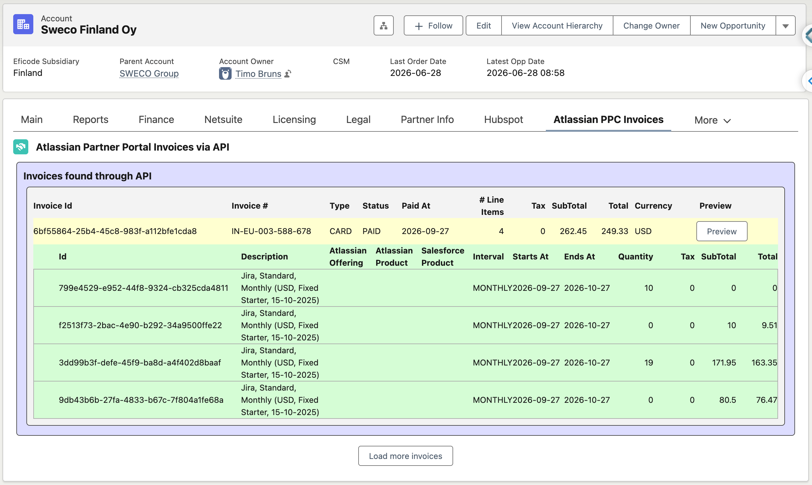

Each invoice is one row: invoice id, invoice number, payment type, status, paid date, line count, tax, subtotal, total, currency, and **Preview**. The lines for that invoice open underneath, with description, Atlassian offering, Atlassian product, the mapped Salesforce product, interval, start, end, quantity, and amounts. **Load more invoices** asks for the next page. In this shot the Account is Sweco Finland Oy, subsidiary Finland, and the open invoice is `IN-EU-003-588-678`, a paid card invoice.

Use the invoice id from this list when importing that invoice onto an Opportunity. **Preview** on a row opens the Atlassian invoice PDF in a new tab. Salesforce does not store the file. See [Quote and invoice PDF preview](Quote_And_Invoice_PDF_Preview.md).

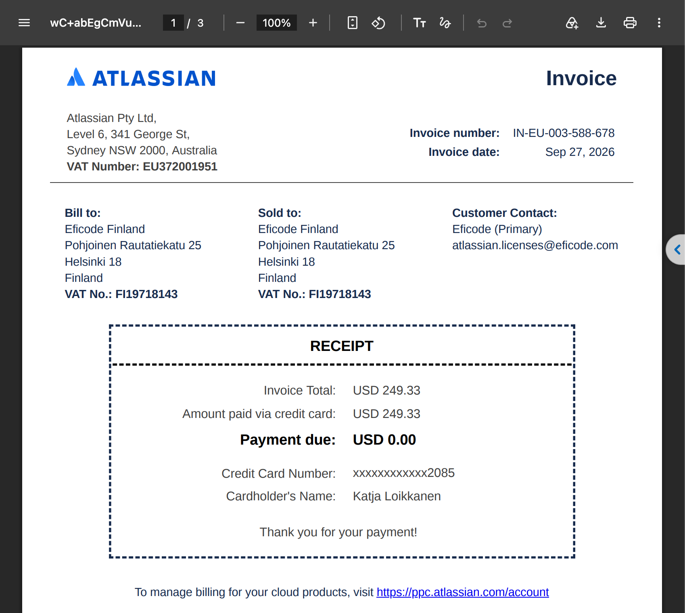

This is **Preview** for `IN-EU-003-588-678`. The tab is the Atlassian PDF, with the invoice number and date, bill-to and sold-to, and the card receipt. It is the same invoice as the row above, not a second copy stored in Salesforce.

---

## Field mapping

### JSON order line → Opportunity Product

Mapped in `OpportunityProductMapper.mapOrderLineToOpportunityLineItem`.

| Opportunity Product field | JSON field |
| --- | --- |
| `License_Start_date__c` | `startDate` |
| `License_end_date__c` | `endDate` |
| `Additional_Info__c` | `description` |
| `Cloud_Site_Name__c` | `cloudSiteHostname` |
| `SEN__c` | `supportEntitlementNumber` |
| `Entitlement_Number__c` | `entitlementNumber` |
| `Renewal__c` | `saleType`, with the translation below |
| `Editable_Cost_Price_in_Dollars__c` | `total` |
| `User_Count__c` | `unitCount` |
| `Atlassian_Price_Adjustment__c` | `priceAdjustment` |
| `Atlassian_Upgrade_Credit__c` | `upgradeCredit` |
| `Atlassian_Partner_Discount__c` | `partnerDiscountTotal` |
| `Atlassian_Loyalty_Discount__c` | `loyaltyDiscountTotal` |
| `QuoteOriginalProduct__c` | `productName` |
| `Quantity` | `1` |
| `Editable_Unit_List_Price_in_USD__c` | `unitPrice - upgradeCredit - loyaltyDiscountTotal` |

`saleType` values:

| Portal `saleType` | `Renewal__c` |
| --- | --- |
| `NEW` | New |
| `RENEWAL` | Renewal (CV Owned) |
| `RENEWAL` when the discount reason is `RENEWAL_PREVIOUSLY_DIFFERENT_EXPERT` | Renewal (New to CV) |
| `UPGRADE` | Upgrade (Same Platform) |
| `DOWNGRADE` | Downgrade (Same Platform) |

### Commerce API quote line → Opportunity Product

Mapped in `PpcOpportunityProductMapper.mapQuoteLineToOpportunityLineItem`.

| Opportunity Product field | Quote bill line |
| --- | --- |
| `License_Start_date__c` | `period.startsAt` (today when missing) |
| `License_end_date__c` | `period.endsAt` |
| `Additional_Info__c` | `description` |
| `Cloud_Site_Name__c` | entitlement name |
| `SEN__c`, `Entitlement_Number__c` | entitlement slug |
| `Editable_Cost_Price_in_Dollars__c` | `amountExcludingTax / 100` |
| `Editable_Unit_List_Price_in_USD__c` | `subTotal / 100` |
| `User_Count__c` | `quantity` |
| `Atlassian_Price_Adjustment__c` | `adjustmentAmount` |
| `Atlassian_Partner_Discount__c` | `discountAmount` |
| `QuoteOriginalProduct__c` | `description` |
| `Quantity` | `1` |
| `Renewal__c` | `salesType` through the map below; unknown types become Renewal (CV Owned) |
| `PpcLineItemId__c` | `quoteLineId` |
| `AtlassianOfferingKey__c` | `offeringId` |

### Commerce API invoice line → Opportunity Product

Mapped in `PpcOpportunityProductMapper.mapInvoiceLineToOpportunityLineItem`.

| Opportunity Product field | Invoice line |
| --- | --- |
| `License_Start_date__c` | `period.startAt` (today when missing) |
| `License_end_date__c` | `period.endAt` |
| `Additional_Info__c` | `description` |
| `Cloud_Site_Name__c` | entitlement name from partner info |
| `SEN__c`, `Entitlement_Number__c` | `entitlementNumber` |
| `Editable_Cost_Price_in_Dollars__c` | `total - tax` |
| `Editable_Unit_List_Price_in_USD__c` | `subTotal` |
| `User_Count__c` | `quantity` |
| `Atlassian_Price_Adjustment__c` | sum of `adjustments.amount` |
| `Atlassian_Partner_Discount__c` | sum of `margins.amount` |
| `QuoteOriginalProduct__c` | `description` |
| `Quantity` | `1` |
| `Renewal__c` | `salesType`, same map as quotes |
| `PpcLineItemId__c` | `orderItemId` |
| `AtlassianOfferingKey__c` | `offeringKey` |

Commerce API sale types (`PpcOpportunityProductMapper`):

| API value | `Renewal__c` |
| --- | --- |
| `NEW` | New |
| `NA`, `RENEW`, `RENEWAL` | Renewal (CV Owned) |
| `RENEWAL_NEW` | Renewal (New to CV) |
| `UPGRADE` | Upgrade (Same Platform) |
| `DOWNGRADE` | Downgrade (Same Platform) |

After insert, Lightning flows still calculate discounts and currencies for the markets those flows cover (including US and UK).

---

## Merging line items

When **Merge Line Items** is checked, `PpcOpportunityProductMapper.mergeEqualProducts` groups lines that share the same `PpcLineItemId__c`, license start date, and license end date.

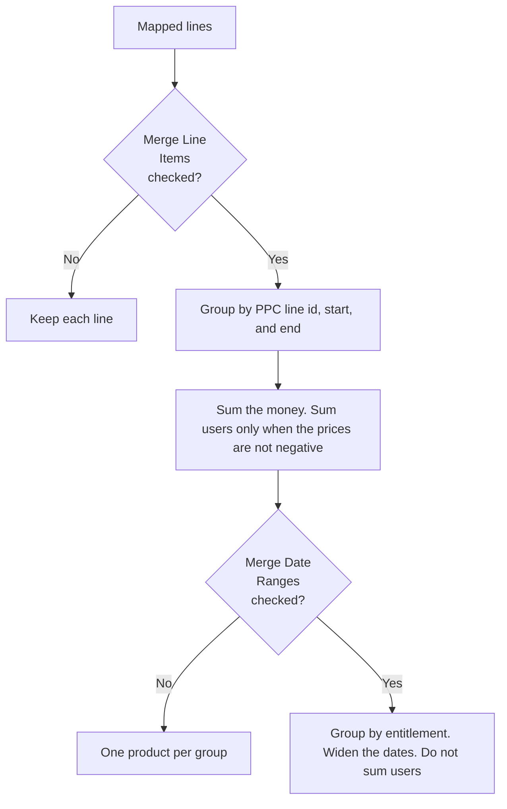

On the kept line it sums:

- `Editable_Unit_List_Price_in_USD__c`
- `Editable_Cost_Price_in_Dollars__c`
- `Atlassian_Partner_Discount__c`
- `Atlassian_Price_Adjustment__c`

User count is summed only for lines whose list price and cost are not negative. A credit line (negative list price or cost) that starts a group has its user count set to 0 so credits do not inflate the seat count.

With **Merge Line Items** unchecked, each mapped line is kept as its own Opportunity Product.

`Merge Date Ranges` is `PPC_InvoiceAutoImportSettings__c.MergeDateRanges__c`, a hierarchy custom setting. It is not the **Merge Line Items** checkbox. `PpcOpportunityProductMapper` reads the org default (or the running user's hierarchy override) and, when the checkbox is on and this field is checked, calls `mergeDateRanges` after the equal-line merge. That groups by `Entitlement_Number__c`, sums the same money fields, and widens the license start to the earliest date and the license end to the latest date. It does not sum user counts.

The same setting is what the monthly job uses. The other fields on **PPC Invoice Auto Import Settings** (automation on/off, days back, pending-invoice cleanup) do not change a manual import. They are described in [Monthly invoice auto-import](Monthly_Invoice_Auto_Import.md#ppc-invoice-auto-import-settings).

---

## Price book entries

Both importers resolve a `Product2` from custom metadata, then a `PricebookEntry` for the Opportunity's price book and currency. A missing price book entry is reported in the error log and that line is not inserted. Add the price book entry, then run the import again.
